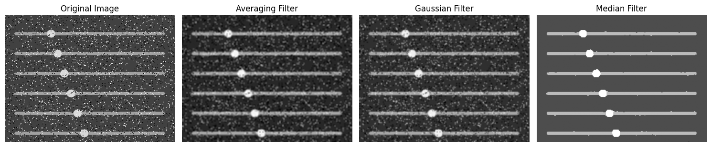

# Image enhancement with OpenCV

What changes when you sharpen an image in the frequency domain, or equalize its contrast one region at a time? This Python notebook compares the outputs side by side. It includes pixel measurements, histograms and saved figures from six experiments completed for UYG332 Image Processing at Istanbul Aydın University.

[Open the notebook with the original results](UYG332Image_Processing_Final_Project.ipynb)



The preview uses the reproducible demo input. The thin tracks remain visible after median filtering, while the box and Gaussian filters spread isolated bright pixels into nearby samples.

| Experiment | What to look for |
| --- | --- |
| Color and pixels | Read an image in BGR, convert it to RGB for display, draw a patch and measure its center pixel. |
| Grayscale negative | Compare five sampled intensities before and after the transformation (255 - I). |
| Nonlinear intensity transforms | Compare logarithmic and exponential mappings after normalization. |
| Sharpening | Compare spatial unsharp masking with an FFT high-pass approach at three sharpening strengths. |
| Noise removal | Inspect the histogram and compare box, Gaussian and median filters on impulse noise. |
| Low contrast | Compare global histogram equalization with contrast-limited adaptive histogram equalization (CLAHE). |

## Run it locally

The original figures are saved in the notebook. To run the code on another machine, generate six small synthetic images in a new directory. Their filenames match the code. The new notebook starts with empty outputs so its figures come from the synthetic images.

From the repository root, in an active Python virtual environment, run

```sh
python -m pip install opencv-python-headless numpy matplotlib jupyterlab
python prepare_demo.py
python -m jupyterlab demo/UYG332Image_Processing_Final_Project.ipynb
```

Select **Run → Run All Cells**. Five pixel coordinates in the negative-image experiment are sampled randomly. To reproduce the coursework figures with your own copy of the original course inputs, place those six files beside the original notebook.

Author · Al-Harath Ahmed Handhal
